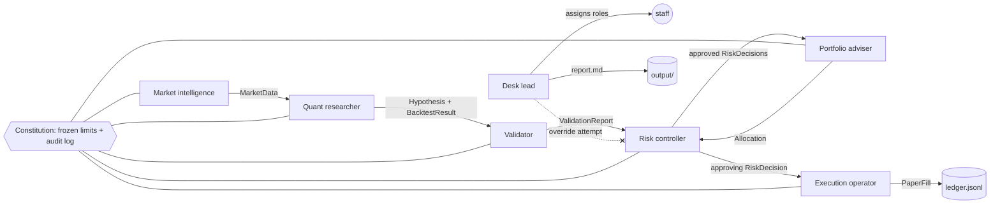

# quant-desk

A small, offline, **role-separated quant research desk** in Python. Seven agents, one
constitution, a fully audited handoff trail, and a markdown desk report at the end of every run.

> [!WARNING]
> **Research, backtesting and paper trading only.** This project contains **no** broker or
> exchange connection, makes **no** network calls, and **cannot** place real orders. The
> execution operator only appends *paper* fills to a local JSONL file. Nothing here is
> investment advice, and a backtest that survives is not evidence of future returns.

Inspired by [@Av1dlive's post on building a 24/7 quant research desk](https://x.com/Av1dlive/status/2107907926321217644)
with role-separated agents. This is a deterministic, test-covered take on that idea: the
"agents" are plain Python objects with fixed roles, not LLMs.

## The constitution

Every rule is enforced in code (`src/quant_desk/constitution.py`) and covered by tests.

1. **Give every agent a role before you give it a task.** An `Agent` gets its `Role` at
   construction. Each role has a fixed set of allowed tasks; asking for anything else raises
   `RoleViolation`, and the attempt is written to the audit log.
2. **No agent grades its own work.** Every artifact carries provenance: author id, role, parent
   hashes and the set of every agent upstream of it. A validator (or risk controller) whose id
   appears in that chain cannot check the artifact; `ConstitutionViolation` is raised and logged.
3. **No lead overrides the risk limits.** `RiskLimits` is a frozen dataclass fixed when the desk
   opens; the constitution object refuses attribute changes. `Constitution.override_veto` always
   refuses, whoever calls it, and logs the attempt. The execution operator only accepts an
   allocation with an approving `RiskDecision` issued by a risk controller for that exact
   allocation hash, and the risk controller only approves an allocation whose source strategies
   each carry an approving strategy decision.

Provenance cannot be forged by hand either: only agents the lead put on the roster may act, an
agent may only publish artifacts under its own name, and every check refuses an artifact that was
never published to the desk or was edited afterwards (its content hash no longer matches). The
audit log is read-only from outside. This is a discipline for in-process code, not a security
boundary: Python code that reaches into private attributes can always get past it.

## The seven roles

| role | does | module |
|---|---|---|
| desk lead | assigns roles, runs the desk, writes the report | `desk.py`, `report.py` |
| market intelligence | synthetic regime-switching prices (seeded) or a local CSV | `market.py` |
| quant researcher | proposes 8 hypotheses, runs vectorised backtests | `research.py` |
| validator | reproduction, lookahead test, deflated Sharpe, IS/OOS, OOS sub-periods | `validation.py` |
| risk controller | approves or vetoes strategies and the final allocation | `risk.py` |
| portfolio adviser | inverse-volatility blend, volatility target, limit caps | `portfolio.py` |
| execution operator | paper fills into `ledger.jsonl` (no broker) | `execution.py` |

## Architecture



Every arrow is an immutable artifact with a SHA-256 content hash and provenance, recorded in
the audit log as it is produced.

## How the checks work

- **Backtest** (`research.backtest`): the position decided at the close of bar *t−1* earns
  the return from *t−1* to *t*, so signals are always shifted one bar. Costs are
  `cost_bps` per unit of turnover, and the book starts flat. Assets are equally weighted.
- **Validator**: 60/40 in-sample/out-of-sample split. A strategy passes only if **all** of these hold:
  - the backtest reproduces exactly from the hypothesis and data;
  - signals are causal: recomputing them on data truncated at several checkpoints must match
    the full-sample signals (a strategy that peeks at tomorrow fails this);
  - IS Sharpe > 0;
  - **deflated Sharpe ratio** ≥ 0.95 (Bailey & López de Prado, 2014), with the number of
    trials = the whole grid;
  - OOS Sharpe > 0;
  - OOS sub-period consistency: most of 3 consecutive OOS sub-periods have a positive Sharpe.
    This is not a full walk-forward: the grid has no fitted parameters, so nothing is re-fit.

  One documented deviation from the DSR paper: `V[SR]` is the null sampling variance of the Sharpe
  estimator, `1/(T−1)` (the variance of a skill-less strategy's Sharpe), not the empirical variance
  across trials. The grid has mirror-image ideas (momentum vs mean reversion), and their genuinely
  opposite Sharpes inflate the cross-trial variance: on seed 7 it would put the expected-maximum
  hurdle at about 1.4 annualised Sharpe instead of about 0.6. The test still bites: with ~1,500
  in-sample days and 8 trials, DSR ≥ 0.95 needs an in-sample Sharpe of roughly 1.3 annualised, and
  on 20 pure random-walk markets no strategy passed the validator (0/160). Treating the 8
  correlated trials as independent also makes the trial penalty conservative.
- **Risk controller**: the strategy needs a PASS verdict, OOS Sharpe ≥ `min_oos_sharpe` and OOS
  max drawdown ≤ `max_oos_drawdown`. The allocation must fit `max_gross_exposure` and
  `max_asset_weight`.
- **Portfolio adviser**: inverse-volatility weights over the trailing year, scaled to a 10%
  volatility target, capped per asset and in gross.

## Quickstart

```bash
python3 -m venv .venv
.venv/bin/pip install -e ".[dev]"
.venv/bin/pytest                                  # 35 tests, under a minute
.venv/bin/quant-desk run --seed 7 --out output/   # writes output/report.md + output/ledger.jsonl
.venv/bin/quant-desk demo                         # same as the line above
.venv/bin/python -m quant_desk run --csv prices.csv --out output/csv-run/
```

The CSV format is long, with columns `date,asset,close`. Dates where any asset is missing are
dropped. Output is deterministic for a fixed seed. The ledger is append-only and idempotent,
so re-running the same seed adds no duplicate fills.

## Sample output (real run, `--seed 7`)

```text
hypotheses tested: 8, survived validation + risk: 1
paper fills: 5 (local ledger only, no broker)
```

| hypothesis | IS Sharpe | OOS Sharpe | OOS max DD | DSR | validator | risk |
|---|---|---|---|---|---|---|
| tsmom(lookback=20) | 0.62 | -0.34 | 28.3% | 0.519 | FAIL | VETO |
| tsmom(lookback=60) | 1.28 | 0.28 | 21.4% | 0.951 | PASS | VETO |
| tsmom(lookback=120) | 0.97 | 0.84 | 9.0% | 0.818 | FAIL | VETO |
| ma_cross(fast=10, slow=50) | 0.69 | 0.28 | 18.5% | 0.593 | FAIL | VETO |
| ma_cross(fast=20, slow=100) | 1.33 | 0.89 | 12.1% | 0.963 | PASS | approved |
| ma_cross(fast=50, slow=200) | 0.80 | 1.11 | 10.9% | 0.687 | FAIL | VETO |
| zrev(window=5) | -1.05 | -1.59 | 32.7% | 0.000 | FAIL | VETO |
| zrev(window=20) | -1.10 | -0.94 | 29.1% | 0.000 | FAIL | VETO |

`tsmom(lookback=60)` passed the validator but was vetoed by the risk controller (OOS Sharpe
0.28 < 0.30 and drawdown 21.4% > 20%). The roles are separate for exactly that reason.
From the same report:

```text
## Constitution drill

The desk lead tried to override a risk veto. Result: blocked. `lead-1 (desk lead) tried to override risk decision f03f50177514; risk vetoes cannot be overridden`

## Honesty

- Hypotheses tried: **8**. Passed validation: **2**. Survived risk: **1**.
- The deflated Sharpe ratio already penalises for the number of trials, but every variant ever tried should count; this run only knows about its own grid.
- A surviving backtest is **not** evidence of future returns. The data is synthetic and was generated with persistent trends, so trend strategies are expected to look good here.
```

## Limitations

- The synthetic market has persistent trend regimes planted on purpose, so the desk has
  something real to find. On real data, expect far fewer survivors.
- The hypothesis grid is fixed (8 variants). The deflated Sharpe ratio only knows about these
  trials, not every idea you have tried before.
- Paper fills rebalance a flat 100k paper book at the last close. There is no slippage model,
  no position carry-over between runs and no corporate actions.

## Layout

```
src/quant_desk/   roles, artifacts, constitution, market, research, validation, risk,
                  portfolio, execution, desk, report, cli
tests/            pytest suite (constitution, roles, backtest maths, lookahead, CSV, determinism)
```

## Licence

MIT © Júlia Muria Solé
